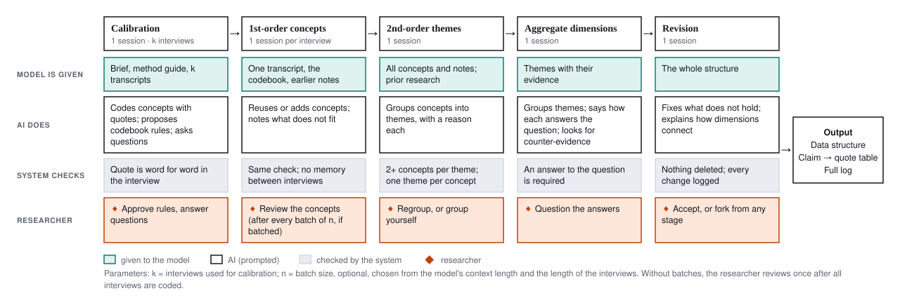
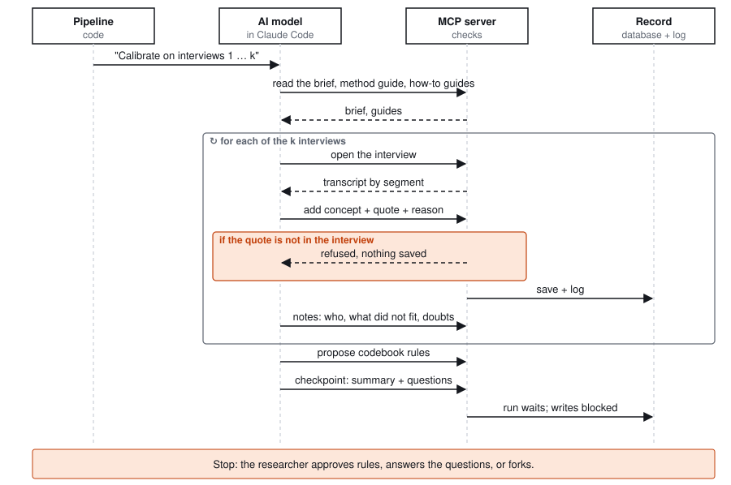
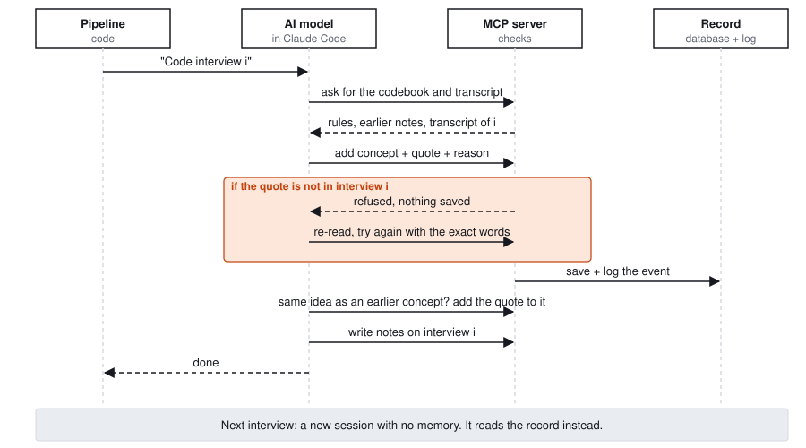
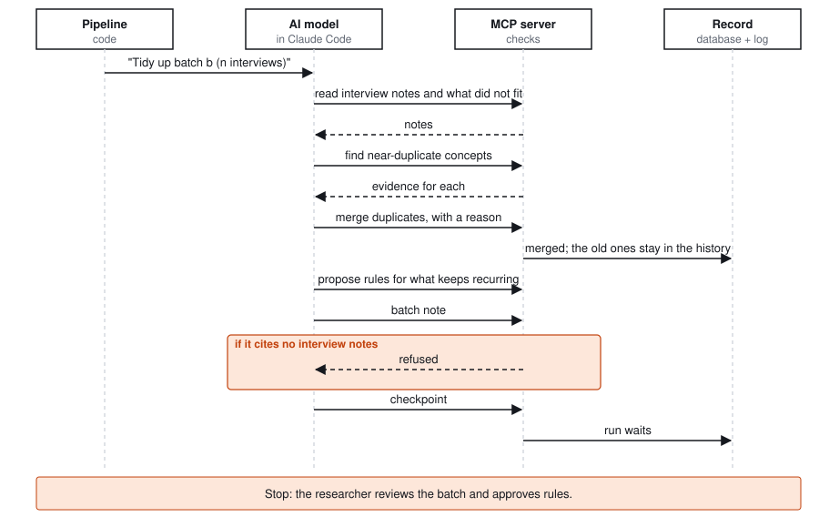
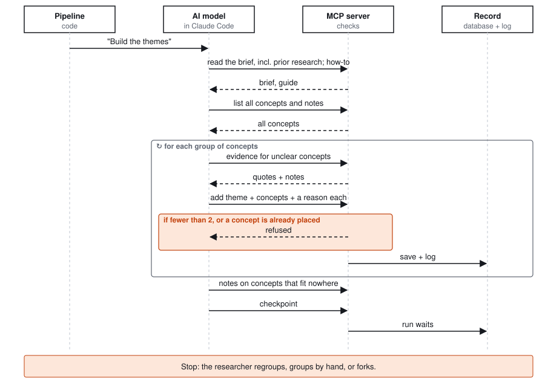
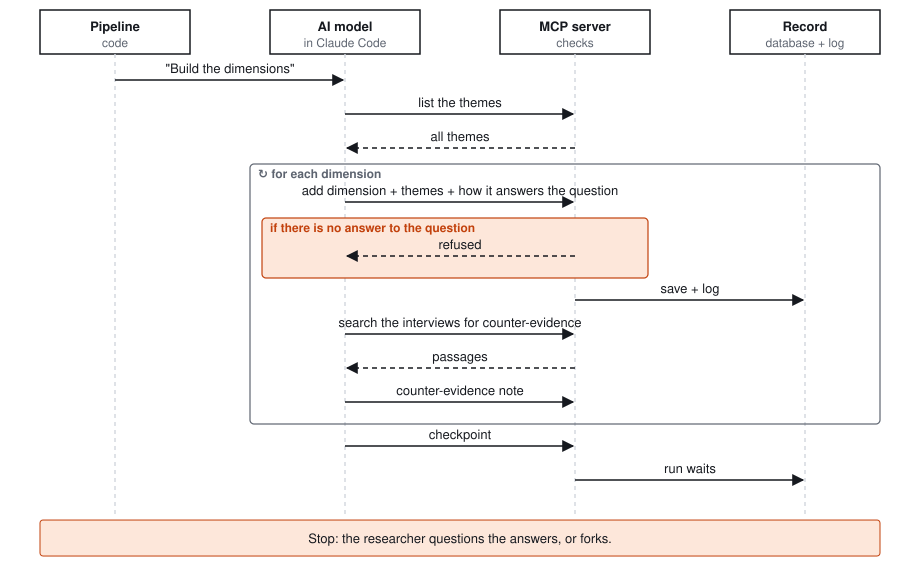
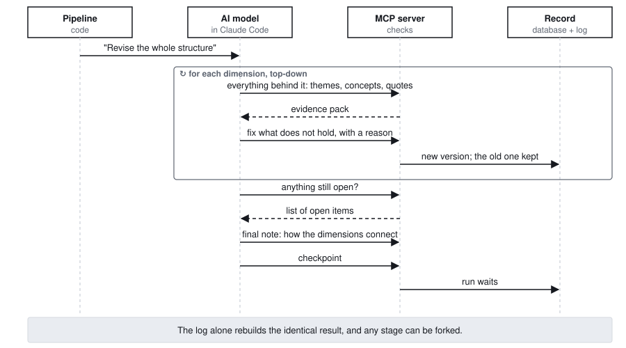

# Pipeline figures (Gioia)

The figures describe the method in general: **k** = interviews used for calibration (picked at
random), **n** = batch size (optional; set from the model's context length and the length of the
interviews). They are drawn by `scripts/figures.py`; change the stages there and rerun it.

## Stages and what happens in each

## Each stage as a sequence

Four lanes: the **pipeline** (the code that starts each session), the **AI model** (one Claude Code
session with the MCP tools and nothing else), the **MCP server** (checks, and refuses what breaks
the method) and the **record** (the TypeDB graph and the SQLite log). Orange marks a refused write
and the stop where the run waits for the researcher.

### Calibration

One session codes k randomly chosen interviews and proposes the first codebook. It ends by stopping
for the researcher with its questions.

### 1st-order concepts (interview i)

One fresh session per interview. The model has no memory of earlier interviews; it reads the
codebook and notes instead.

### Batch tidy-up (optional)

With large corpora, interviews are coded in batches of n; after each batch, one session looks across
it before the researcher reviews.

### 2nd-order themes

The model now works from the record, not from transcripts. Prior research comes in at this stage.

### Aggregate dimensions

Each dimension must answer the research question, and each is tested against the interviews.

### Revision

One session reads the structure top-down and writes how the dimensions connect.

---

Plain-language overview: [how-it-works.md](how-it-works.md) · design: [pipeline.md](pipeline.md)
